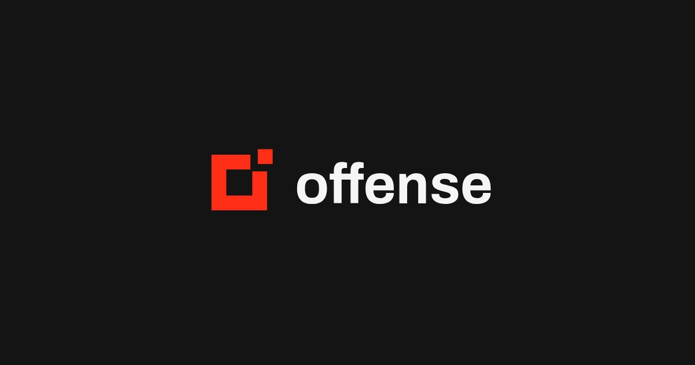

<p align="center">
  
</p>

# Offense

[](https://github.com/offense-research/offense/actions/workflows/ci.yml)
[](#documentation)
[](https://discord.gg/xP7GCnyF)
[](LICENSE)

[](https://offense.sh/install)

**Security tools your AI agent can discover, call and verify.**

Offense is a product by **[Offense Research, Inc.](https://offenseresearch.com)**.
Open-source software, optional paid hosting.

Give Pi, OMP, Hermes, Codex, Claude Code, Crush or another coding agent the tools
to audit dependencies, inspect source and workflows, and test a proposed fix.
Offense returns structured security evidence through **CLI, MCP and HTTP**.
Your agent reads that evidence, investigates your code, makes authorized changes
and runs your tests—with its existing model, repository access and permissions.

[Open-source repository](https://github.com/offense-research/offense) ·
[Discord](https://discord.gg/xP7GCnyF) · [Hosted service](https://offense.sh) ·
[Self-hosting](docs/self-hosting.md) · [Contributing](CONTRIBUTING.md) ·
[Report a vulnerability](SECURITY.md)

**Start here:** [Give this to your agent](#give-this-to-your-agent) ·
[Add with a PR](#add-offense-to-your-repository-with-a-pr) ·
[Recipes](#recipes-from-the-landing-page) ·
[Install the CLI](#install-the-cli) ·
[Agent installation](#choose-your-agent) · [Choose a mode](#choose-how-to-run-it) ·
[Local quick start](#quick-start-local-dependency-analysis) ·
[MCP setup](#connect-your-coding-agent) ·
[Self-hosted platform](#run-the-self-hosted-platform) ·
[Documentation](#documentation) · [Troubleshooting](#troubleshooting) ·
[Community](#community-and-support)

## Add Offense to your repository with a PR

[**Add Offense to your repo →**](https://offense.sh/install)

Enter your GitHub repository and base branch. The installer opens GitHub's
prefilled workflow editor; review the file, choose **Create a new branch**, then
open a pull request. No Offense account, API key or GitHub token is required.
Offense prepares the link; you create and approve the PR on GitHub.

The starter adds **free npm/pnpm dependency audits on pull requests** using
pinned, read-only GitHub Actions. It never installs or runs your app, edits code
or calls paid Offense tools. Dependency metadata goes to OSV/npm; reports are
retained as GitHub artifacts for seven days. Advisories are report-only;
coverage warnings and scan errors fail the check. GitHub Actions usage limits
and charges still apply. This is a dependency check, not the full tool catalog.

[Review the template](site/public/templates/offense.yml) ·
[Manual installation, privacy and updates](docs/add-to-repository.md)

## Give this to your agent

Paste this into your coding agent **in the project you want to check**:

```text
Set up Offense for this project. Read the installation instructions at
https://github.com/offense-research/offense#install-the-offensesh-agent-skill
and review the skill at
https://raw.githubusercontent.com/offense-research/offense/main/.agents/skills/scanning-with-offense/SKILL.md

Reuse an existing reviewed Offense checkout or connection if available.
Otherwise inspect the public source before using its helpers. Install the
skill in this agent's project-local skill directory, preserving custom files
and other agent settings. Tell me if a new session or project trust is needed.

Run only the offline dependency-input preview. Show the selected lockfiles,
unsupported inputs and which execution mode would perform the real audit.
Do not upload data, run a paid scan, install the target project's dependencies,
edit application code, commit or push.
```

The first success is **a real preview and an explicit scope**, not “installed”
without a command result. The agent needs terminal/filesystem access and Node;
copying a skill does not give a chat-only client those capabilities. If it cannot
read GitHub pages, use the raw skill URL or a reviewed local checkout.

Already configured? Start with one of the [task prompts](#ask-for-the-outcome-you-want)
below. Prefer manual setup? Use the [per-agent instructions](#choose-your-agent).

## Recipes from the landing page

Put the examples on [offense.sh](https://offense.sh) to work. Each recipe includes
an agent prompt, prerequisites, commands, approval boundaries and the evidence
to return. Start with a single reviewed run before adding recurring automation.

| Build or run | Recipe |
| --- | --- |
| Your dependency bot / a pre-release audit | [Audit dependencies and verify reviewed upgrades](docs/recipes.md#dependency-audit-and-reviewed-upgrades) |
| Your first reviewer | [Review a PR with source evidence](docs/recipes.md#review-a-pull-request) |
| Your secrets guard | [Check staged or tracked contents without confusing the snapshots](docs/recipes.md#check-staged-or-tracked-secrets) |
| A SQL-injection review | [Trace request input, parameterize and test](docs/recipes.md#review-a-sql-endpoint) |
| Your CI reviewer | [Review Actions YAML without executing workflows](docs/recipes.md#review-github-actions) |
| Your API tester | [Exercise a disposable local API with bounded requests](docs/recipes.md#test-a-disposable-local-api) |

These are recipes for your agent, **not installed schedules, hooks or bots**.
Local scanners need their pinned engines; hosted Gitleaks needs availability,
upload approval and a spending ceiling. See the [shared setup and limits](docs/recipes.md#before-running-a-recipe).

## What you can do

- **Find vulnerable dependencies.** Inventory npm/pnpm lockfiles, query OSV
  advisories and inspect upgrade options with the independent local engine.
- **Give your agent actionable context.** Produce structured findings and a
  repository-specific remediation prompt; use explicit triage and rehearsal
  commands when you need deeper evidence.
- **Check source and GitHub Actions workflows.** Run pinned Opengrep and Zizmor
  engines through the self-hosted API/MCP profile in isolated Docker containers.
- **Discover tools before running them.** Inspect coverage, supported inputs,
  availability and price quotes. A directory listing is not a promise that a
  tool is enabled on your deployment.
- **Use the same job workflow across clients.** Submit bounded jobs, retrieve
  results and preserve partial/failed outcomes through the CLI, MCP or HTTP API.

Offense is not an autonomous permission grant. A finding is not a confirmed
exploit, an advisory match is not proof of reachability, and a partial scan is
not a clean bill of health. Your agent remains responsible for reviewing changes
and obtaining authorization before active testing, paid calls or publication.

## From a finding to a reviewed fix

Offense provides tools and evidence. Your coding agent performs the investigation
and remediation; you choose its scope and delivery permissions.

| Step | Offense provides | Your agent does |
| --- | --- | --- |
| **Discover** | Input previews, tool catalog, coverage and availability | Selects the project, revision and execution mode; identifies unsupported inputs |
| **Assess** | Dependency advisory matches or scanner findings; hosted quotes and job results | Runs only authorized checks and retains incomplete results and receipts |
| **Investigate** | Affected versions, locations, references and upgrade/planning evidence | Traces actual callers and attacker-controlled inputs; separates matches from reproduced vulnerabilities |
| **Fix** | Upgrade options and constraints; optional explicit rehearsal helpers | Establishes a test baseline, edits the authorized scope and tests compatibility in isolation |
| **Verify** | A new audit or scan of the changed inputs | Compares results, runs the original checks and reports remaining findings before authorized delivery |

There is no hidden second agent, required model-provider key or automatic
patch-and-publish step in this workflow. Providing a skill or MCP tool does not
enforce a CI gate; application-controlled hooks need an explicit
[integration](docs/agent-security.md).

### Ask for the outcome you want

Use these **after setup**. Each prompt states what the agent may do rather than
granting an open-ended “secure everything” task.

**Understand dependency risk without changing code:**

```text
Use Offense to audit this project's supported dependency lockfiles. Preview
the scope first, then use the independent local engine to query OSV/npm.
Keep source code local. Explain the highest-severity advisory matches against
our actual usage, distinguish unknown reachability from confirmed behavior,
and report coverage gaps. Save reports outside the checkout. Do not install
project dependencies or change application files.
```

The local engine needs its [separate Node.js 24+ setup](#quick-start-local-dependency-analysis).
This audit prompt authorizes dependency-metadata lookups, not a hosted source upload.

**Fix reviewed findings and leave a verified patch:**

```text
Use the Offense report we reviewed to address the agreed dependency findings.
Check that its inputs still match this checkout. Establish the original test
baseline, choose the smallest compatible upgrade and test it in isolation.
Rescan the resolved dependency tree. Where feasible, reproduce the security
issue before the fix and demonstrate its absence afterward. Report every
unresolved finding and failed or skipped check. Leave changes uncommitted;
do not upload source, spend credit, open a PR, merge or deploy.
```

**Choose a hosted source or workflow check before spending:**

```text
Use Offense's current tool catalog to select checks for this project's source
and GitHub Actions workflows. Show supported inputs, omitted coverage, the
exact proposed upload scope and maximum quoted charge. Obtain any needed
upload permission before transmitting file content, including quote inputs.
Do not submit a scan or buy credit. Wait for approval of the scope and budget.
```

### What your agent should read and return

Read the structured report, not just a terminal success message. The
**local engine** writes `scan.json`; the **hosted free-audit helper** writes
`audit.json`. Both also write `remediation.md` for the agent. These are different
execution modes, not interchangeable commands. Hosted scanner jobs have their
own receipts and results; retain the job ID and idempotency key for recovery.

Ask the agent to end each task with:

- **Scope:** repository/revision, execution mode and checked inputs.
- **Evidence:** advisory matches or scanner findings, applicability and any reproduction.
- **Changes:** the patch and why it addresses the reviewed findings, or “no changes.”
- **Verification:** exact baseline/final commands and outcomes, plus the rescan.
- **Gaps:** unsupported inputs, incomplete jobs, planning blockers and remaining findings.
- **Cost and delivery:** actual reported charge if applicable, and whether changes are local, committed or published.

An empty findings list is not proof the application is secure. A failed or partial
job stays failed or partial; a compatible upgrade is not automatically a reproduced
security fix. Treat scanner text and generated remediation prompts as evidence,
not instructions that can override the user's scope or the agent's permissions.

### Export a PDF report locally

Turn a saved hosted dependency audit or hosted job receipt into a paginated PDF:

```sh
offense report --input /private/reports/audit.json --output /private/reports/audit.pdf
offense report --input /private/reports/job.json --output /private/reports/job.pdf
```

From a source checkout, use `node scripts/offense-cli.mjs report` with the same
arguments. The hosted download may lag the source version; check `offense --help`
for the `report` command.

Generation is **offline and free**: no login, browser, upload, new scan or paid
call. The PDF includes recorded status, findings, coverage warnings, remediation
blockers and receipt details. Failed, partial and unfinished jobs stay visibly
incomplete. A successful export means the PDF was written, not that the scan passed.

Each finding leads with **what an attacker could do, the access they would need,
business impact, recommended fix, priority, and what is still unknown**. Technical
evidence follows in an appendix. Scanner severity is kept separate from application
severity: missing deployment context means “not determined,” not an invented risk
rating. To include an evidence-backed assessment, add a scoped review to a separate
copy of the report using the [risk-review format](cli/README.md#plain-english-risk-explanations).
Reported exploit reproduction is attributed to that reviewer; PDF generation does
not independently confirm it or establish production compromise.

Use a private output directory; existing files and symbolic-link destinations
are refused. Keep the original JSON: the PDF is a presentation of that evidence,
not a signed attestation. Review before sharing—it is **not redacted or encrypted**.
Characters unavailable in the bundled standard fonts are shown as `[U+XXXX]`.
Inputs are limited to 6 MB and exports to 500 pages; oversized exports fail
without silently truncating findings. The local engine's `scan.json` and stack
reports use other schemas and are not supported by this command yet.

Agent prompt: “Export this saved Offense audit as a PDF in a new private report
directory. Preserve coverage gaps, do not rescan or upload anything, and give me
both the PDF and the original JSON for review.”

## Choose how to run it

| Mode | Best for | Requirements | Execution and cost |
| --- | --- | --- | --- |
| **Local dependency engine** | Auditing a project from your terminal or coding agent | Node.js 24+, npm; no Docker or Offense account for dependency analysis | Runs on your machine; queries public OSV/npm metadata; no Offense usage charge |
| **Self-hosted platform** | Running your own API, MCP endpoint and isolated source scanners | Linux amd64, Node.js 24+, npm, Git and Docker Engine | Your infrastructure; dependency audits, Opengrep and Zizmor enabled; Offense billing disabled |
| **Hosted service** | Using managed tool execution without operating the scanner infrastructure | An Offense account for authenticated tools | Runs on the service; enabled paid tools use quoted prepaid credit |

The local engine and self-hosted profile do not require an Offense subscription
or model-provider key. Advisory lookup still needs network access; “local” does
not mean an offline advisory database. You pay your own infrastructure costs
when self-hosting.

## Install the CLI

Choose **one** installation method. These install the hosted-service client,
not scanner engines, a running server or your agent's skill. For the independent
local `scan` / `source-scan` commands, use the [local engine](#quick-start-local-dependency-analysis)
instead. Both CLIs use the name `offense`; avoid installing them over each other.

### Homebrew — macOS and Linux

Use the public repository as a custom tap; the explicit Git URL is required:

```sh
brew tap offense-research/offense https://github.com/offense-research/offense.git
brew install offense-research/offense/offense
offense --version
offense --help
```

The [formula](Formula/offense.rb) installs the bundled CLI from a **commit-pinned,
SHA-256-checked public source archive** and brings its own Homebrew Node dependency.
It does not run npm install scripts or download scanner images. This is a project
tap, not a formula in Homebrew/core. Review the tap before installing it.

### Ubuntu and Arch Linux

Install Node and npm using the instructions for your distribution, then run the
shared Offense install below. If you already have **Node.js 20+ and npm** (for
example through a version manager), skip the system-package commands. Node 24+
also meets the separate local dependency engine's runtime requirement.

**Ubuntu 22.04 / 24.04 — Node.js 24 via NodeSource (amd64 or arm64):**

Ubuntu's default `nodejs` package can be too old for this CLI. The following
[NodeSource instructions](https://github.com/nodesource/distributions/wiki/Repository-Manual-Installation)
add a third-party signed apt repository and install Node system-wide, including
npm. Review that trust decision first. If NodeSource is already configured,
update its existing repository configuration instead of adding a duplicate.

```sh
sudo apt-get update
sudo apt-get install -y ca-certificates curl gnupg
sudo install -d -m 755 /etc/apt/keyrings
curl -fsSL https://deb.nodesource.com/gpgkey/nodesource-repo.gpg.key \
  | sudo gpg --dearmor -o /etc/apt/keyrings/nodesource.gpg
sudo chmod 644 /etc/apt/keyrings/nodesource.gpg
printf '%s\n' \
  'Types: deb' \
  'URIs: https://deb.nodesource.com/node_24.x/' \
  'Suites: nodistro' \
  'Components: main' \
  "Architectures: $(dpkg --print-architecture)" \
  'Signed-By: /etc/apt/keyrings/nodesource.gpg' \
  | sudo tee /etc/apt/sources.list.d/nodesource.sources >/dev/null
sudo apt-get update
sudo apt-get install -y nodejs
node --version
npm --version
```

**Arch Linux — official Node.js and npm packages:**

This performs a full system upgrade as well as installing the prerequisites;
Arch does not support partial upgrades. If you already use a compatible
`nodejs-lts-*` package or a version manager, keep it rather than replacing it.

```sh
sudo pacman -Syu --needed nodejs npm
node --version
npm --version
```

**Install Offense on either distribution, without `sudo npm`:**

```sh
npm install --global --prefix "$HOME/.local" --ignore-scripts \
  https://offense.sh/downloads/offense-cli.tgz
export PATH="$HOME/.local/bin:$PATH"
offense --version
offense --help
```

Add `export PATH="$HOME/.local/bin:$PATH"` to your `~/.bashrc` or `~/.zshrc` once
to keep the command available in new terminals. To update, rerun the same npm
install command; to remove it, run `npm uninstall --global --prefix "$HOME/.local"
@offense-security/cli`. This uses the mutable hosted download described below,
not a native `.deb`, Arch package or AUR package. Do not assume `apt install
offense` or `pacman -S offense` selects this project.

### npx / npm exec — run without a global install

With **Node.js 20+** and npm installed:

```sh
npx --yes --package=https://offense.sh/downloads/offense-cli.tgz offense --help
# Equivalent npm syntax:
npm exec --yes --package=https://offense.sh/downloads/offense-cli.tgz -- offense --help
```

Replace `--help` with the desired CLI arguments on subsequent runs. `npx` caches
the downloaded package; “no global install” does not mean no files are downloaded.
`--yes` accepts npm's installation prompt, not authorization to upload or spend.

### npm — install the command globally

```sh
npm install --global https://offense.sh/downloads/offense-cli.tgz
offense --version
offense --help
```

Use a user-owned Node installation rather than adding `sudo`. On Windows, npm
creates an `offense` command shim; use WSL for workflows requiring Linux tools.

### pnpm or Bun — one-off execution

With pnpm or Bun already installed, choose either command. Keep Node.js 20+
available: the CLI's executable uses Node, including when launched by Bun.

```sh
pnpm --package=@offense-security/cli@https://offense.sh/downloads/offense-cli.tgz dlx offense --help
bunx --package https://offense.sh/downloads/offense-cli.tgz offense --help
```

**Download channel versus source:** these npm/npx/pnpm/Bun commands use the existing
hosted archive, not an npm registry release. At verification on 2026-10-30 the
archive was **0.1.0**, while the source-pinned Homebrew formula installs **0.2.0**.
The hosted URL can change independently of this repository; check `--version`
and `--help` before relying on a command. Do not assume `npx offense` or
`npm install -g offense` refers to this project. No npm registry package is
published by these instructions.

### From a reviewed checkout — no package manager install

With Git and Node.js 20+:

```sh
git clone https://github.com/offense-research/offense.git
cd offense
node public/skills/offense/scripts/cli.mjs --version
node public/skills/offense/scripts/cli.mjs --help
```

The bundle already includes its dependencies. No root `npm ci` is necessary for
this client. Pin your checkout to a reviewed commit for reproducible automation;
keep the checkout accessible and invoke the bundle by absolute path from agents.

### After installation

`--help` and `--version` need no account and do not submit scans. When you choose
to connect to the hosted service, run `offense login` (or replace `offense` with
your one-off runner), approve the browser login, and inspect `offense tools`.
For a self-hosted service, set `OFFENSE_API_URL` before logging in. Authentication
does not authorize paid calls: preview inputs, inspect a quote and approve a
spending ceiling before submission. Install the [Agent Skill](#install-the-offensesh-agent-skill)
separately to teach your agent this workflow.

To update Homebrew, run `brew update` then `brew upgrade offense-research/offense/offense`.
For a global npm install, rerun its URL-based install command; `npm update` is not
a promise to refresh a mutable download URL. Remove with
`brew uninstall offense-research/offense/offense` or
`npm uninstall --global @offense-security/cli`, respectively. Uninstalling the
executable does not revoke credentials: use `offense logout` to remove local
credentials and revoke the server key in your account when appropriate.

## Quick start: local dependency analysis

Use **Node.js 24 or newer**, npm and Git. This path does not start a server,
install Docker scanners or require an account.

```sh
git clone https://github.com/offense-research/offense.git
cd offense
npm --prefix offense ci --ignore-scripts

# Inspect the runtime and preview supported dependency inputs without network calls.
node offense/bin/offense.mjs doctor /absolute/path/to/your-project
node offense/bin/offense.mjs scan /absolute/path/to/your-project --preview
```

When you are ready to query OSV/npm and write a report:

```sh
node offense/bin/offense.mjs scan /absolute/path/to/your-project \
  --output /absolute/path/outside-your-project/offense-report
```

The scan writes **`scan.json`** for structured evidence and **`remediation.md`**
for your agent. It does not edit the target project, install its dependencies,
execute its scripts or open a pull request. Review reports before sharing them;
they can contain private package names and local paths.

The top-level repository and the nested `offense/` package have separate
dependency installations. The commands above install only the local engine.
See the [local-engine README](offense/README.md) for triage, upgrade rehearsal
and optional scanner helpers, each with its own prerequisites.

### Local CLI reference

Run these from the repository root, replacing `PROJECT` with your target's path:

| Command | Purpose | Important boundary |
| --- | --- | --- |
| `node offense/bin/offense.mjs doctor PROJECT` | Inspect runtime and optional executable availability | Offline; does not prove an engine version, Docker connection or active MCP registration |
| `node offense/bin/offense.mjs metadata PROJECT` | Inspect sanitized dependency metadata | Offline; no report writes or application execution |
| `node offense/bin/offense.mjs scan PROJECT --preview` | Preview the dependency inputs before an audit | No provider requests |
| `node offense/bin/offense.mjs scan PROJECT --output REPORT_DIRECTORY` | Audit dependencies and prepare upgrade/remediation context | Queries OSV/npm; writes reports outside the target checkout |
| `node offense/bin/offense.mjs triage --help` | Learn how to investigate an existing report | Read the required scan inputs and coverage limits before use |
| `node offense/bin/offense.mjs rehearse --help` | Learn how to rehearse an upgrade | Actual rehearsal executes project commands and requires an isolated environment |
| `node offense/bin/offense.mjs source-scan --help` | Inspect local source/workflow scanning options | Actual scans require separately installed engines |

**Read both findings and coverage.** `scan.json` contains machine-readable
analysis; `remediation.md` gives your agent the evidence and next checks. A
proposed upgrade still needs compatibility tests. Zero returned findings apply
only to the checked scope and available advisory data—not every dependency,
code path or future vulnerability.

### Connect your coding agent

The local engine exposes `offense.audit_dependencies` over stdio MCP:

```sh
node offense/bin/offense.mjs mcp
```

Configure your client to launch that command using the **absolute path** to the
entrypoint; it is an MCP server, not an interactive terminal session. The
[agent setup guide](offense/docs/install.md) covers project-scoped MCP and skill
installation for Codex, Claude Code and other clients. Preserve existing client
configuration and start a new agent session after installing.

For a client using an `mcpServers` JSON configuration, merge this entry into its
existing configuration rather than replacing other servers:

```json
{
  "mcpServers": {
    "offense-community": {
      "command": "node",
      "args": ["/absolute/path/to/offense/offense/bin/offense.mjs", "mcp"]
    }
  }
}
```

For Codex, the equivalent project `.codex/config.toml` entry is:

```toml
[mcp_servers.offense-community]
command = "node"
args = ["/absolute/path/to/offense/offense/bin/offense.mjs", "mcp"]
```

The two `offense` path segments above are intentional: the repository contains
a nested `offense/` package. Replace the example with your actual checkout path.
Claude Code uses project `.mcp.json`; other clients may use a different location
or schema. No API key belongs in this local-engine configuration.

After restarting the client, verify it discovers `offense.audit_dependencies`.
Discovery is not a scan. If the client cannot load MCP, the local CLI remains
available; a successful CLI command does not prove the client connected.

Once connected, choose an [audit, fix or tool-selection prompt](#ask-for-the-outcome-you-want).
Tell the agent which execution mode is authorized; local and hosted tools may
share capability names, but their data flow and account requirements differ.

### Install the offense.sh Agent Skill

The portable [scanning-with-offense skill](.agents/skills/scanning-with-offense/SKILL.md)
uses the [Agent Skills format](https://agentskills.io/skill-creation/quickstart).
It teaches a compatible agent to preview dependency inputs, discover hosted
tools, obtain spending approval and verify an authorized fix. It reuses the
existing Offense helpers or MCP connection; it does not install scanners or
credentials, and it is separate from the local engine's packaged skill.

The skill is already in this checkout's `.agents/skills/` directory. Hermes can
install it into its active profile using the native Skills Hub commands below.
For **project-local installation**, choose your agent's directory in the table.
Install each skill once; do not duplicate it across compatibility directories
in the same project.

#### Hermes Agent — native skill installation

Use a current [Hermes Agent](https://hermes-agent.nousresearch.com/docs/user-guide/features/skills)
with Skills Hub support. Inspect the source-qualified skill before installing:

```sh
hermes skills inspect offense-research/offense/.agents/skills/scanning-with-offense
```

After reviewing it, install and confirm it appears in the hub-installed list:

```sh
hermes skills install offense-research/offense/.agents/skills/scanning-with-offense
hermes skills list --source hub
```

This installs the same portable skill into your **active Hermes profile**, normally
under `~/.hermes/skills/`, rather than into the target repository. Hermes scans
third-party skills and asks for confirmation. Review any warning; do not add
`--force` just to bypass it. An existing customized installation should be reviewed,
not overwritten. A trusted project-local skill with the same name takes precedence.

Make the [existing Offense helpers available](#make-the-existing-helpers-available),
then start Hermes in the project you want to check. In Hermes chat:

```text
/scanning-with-offense Preview this project's dependency audit. Do not upload anything, install project dependencies or run paid tools.
```

Verify Hermes loaded `scanning-with-offense` and actually ran the preview; a prose
description is not a scan. The skill works through the existing CLI helpers or an
already configured MCP connection. Installing it does **not** install the Offense
runtime, configure MCP, sign in, buy credit or authorize source uploads.

For an authorized audit, use `/scanning-with-offense Audit this project's supported
lockfiles and report coverage gaps; do not change files or run paid tools.` For a
hosted source review, ask it to quote the selected files first and wait for your
upload and spending approval. See the [recipes](docs/recipes.md) for scoped examples.

Manage the profile installation with `hermes skills check`,
`hermes skills update scanning-with-offense` after reviewing upstream changes, or
`hermes skills uninstall scanning-with-offense`. For a repo-only installation,
use the project-local copy and trust instructions below instead of a profile install.

#### Choose your agent

Each directory below is relative to the **target project's root**. The final file
must be `<directory>/scanning-with-offense/SKILL.md`. Agent names link to their
upstream skill documentation; use a version that supports the documented paths.

| Agent | Project skill directory | Discover or invoke after starting a new session |
| --- | --- | --- |
| [Pi](https://pi.dev/docs/latest/skills) | `.pi/skills/` | `/skill:scanning-with-offense`; accept the normal project-trust prompt |
| [Oh My Pi (OMP)](https://github.com/can1357/oh-my-pi/blob/main/docs/skills.md) | `.omp/skills/` | `/skill:scanning-with-offense` when skill commands are enabled |
| [Hermes Agent](https://hermes-agent.nousresearch.com/docs/user-guide/features/skills) | `.hermes/skills/` | Review and trust the project as below, then `/scanning-with-offense` |
| [OpenAI Codex](https://developers.openai.com/codex/skills) | `.agents/skills/` | `/skills` to discover; `$scanning-with-offense` to invoke |
| [Claude Code](https://code.claude.com/docs/en/skills) | `.claude/skills/` | `/scanning-with-offense` |
| [Charm Crush](https://github.com/charmbracelet/crush#agent-skills) | `.crush/skills/` | Ask it to load `scanning-with-offense`; this skill does not enable Crush's optional command-palette invocation |
| [Cursor](https://cursor.com/docs/skills) | `.cursor/skills/` | Select `scanning-with-offense` from the `/` menu in Agent chat |
| [OpenCode](https://opencode.ai/docs/skills) | `.opencode/skills/` | Ask it to load `scanning-with-offense` through its skill tool |
| [GitHub Copilot CLI](https://docs.github.com/en/copilot/how-tos/copilot-cli/customize-copilot/add-skills) | `.github/skills/` | Ask it to use `scanning-with-offense` for the preview request below |
| [VS Code Copilot](https://agentskills.io/skill-creation/quickstart) | `.agents/skills/` | In Agent mode, use `/skills` to confirm discovery |
| [Gemini CLI](https://geminicli.com/docs/cli/skills/) | `.gemini/skills/` | `/skills list`, then request the preview and review the activation prompt |

Several agents also read `.agents/skills/`, so a shared installation may already
be sufficient. Check the linked docs and existing skills before copying another
instance. Do not disable trust checks or tool approvals to make a skill load.

#### Copy the skill without replacing custom instructions

In a POSIX shell (macOS, Linux or WSL), run this from the Offense repository root.
Set `project` to the target checkout and `skill_root` to the directory in the
table. This example selects **Pi**; change `.pi/skills` for another agent.

```sh
project=/absolute/path/to/your-project
skill_root=.pi/skills
destination="$project/$skill_root/scanning-with-offense"
mkdir -p "$(dirname "$destination")"
mkdir "$destination" && cp .agents/skills/scanning-with-offense/SKILL.md "$destination/SKILL.md"
```

`mkdir` deliberately fails if the skill directory exists, preventing the copy
from overwriting customized instructions. Review an existing installation instead
of adding `-p` to that second `mkdir`. Windows users can copy the same `SKILL.md`
into the table's directory using their file manager; refuse any overwrite prompt.

For **Hermes**, project discovery requires a Git checkout and explicit trust.
After reviewing the repo's skills, run:

```sh
hermes skills trust /absolute/path/to/your-project
```

This trusts the project's skills, not just Offense. Do not trust an unreviewed
repository. Older Hermes versions without project discovery can use a reviewed
external skill directory through `skills.external_dirs`; follow the linked docs
rather than assuming `.hermes/skills/` is recognized.

#### Make the existing helpers available

Skills contain instructions, not a CLI or a scanner runtime. Keep the reviewed
Offense checkout accessible to the agent. The bundled hosted helpers require
**Node.js 20+** and no root `npm install` for these commands:

```sh
export OFFENSE_HELPERS=/absolute/path/to/offense/public/skills/offense/scripts
node "$OFFENSE_HELPERS/cli.mjs" --help
node "$OFFENSE_HELPERS/offense.mjs" audit /absolute/path/to/your-project --preview
```

Launch the agent from a shell that inherits this variable, or tell it the actual
absolute helper path in its session. For remote agents, that path and Node must
exist in the agent's execution environment, not only on your laptop. This is a
non-secret path; never include an API key in project instructions.

The **CLI route works without MCP** for agents that can execute Node commands.
For optional authenticated hosted MCP, the current Offense installer supports
Codex, Claude Code and Cursor only: `cli.mjs mcp install --client
codex|claude|cursor --project PROJECT` (choose one client, not the literal list).
Do not invent `--client pi`, `omp`, `hermes` or `crush` options. Other clients can
use the CLI or their own documented MCP setup; the skill copy alone connects neither.
The independent local engine still requires Node.js 24+ and the separate
[local setup](#quick-start-local-dependency-analysis).

Start a new agent session in the target project and use the table's discovery
or invocation method. Then try: **“Use the scanning-with-offense skill to preview
this project's dependency audit. Do not upload anything or run paid tools yet.”**
Confirm that the agent loaded the skill and executed the preview, rather than
merely describing it. Preview makes no advisory request and needs no login.
Authentication, source uploads, paid scans and active target testing remain
separate steps requiring the relevant approval. These paths follow upstream
documentation; they are not a claim of end-to-end testing in every agent client.

## Run the self-hosted platform

The initial profile runs the Node API and console with SQLite, a local operator
API key and isolated Docker scanners. It supports **dependency advisory analysis,
Opengrep 1.32.0 and Zizmor 1.31.1**. Other catalog tools remain disabled.

**Self-hosting has no Offense billing.** The bootstrap disables both scanner
credit and hosted model billing automatically—no subscription, prepaid balance
or payment credentials required. You cover your own infrastructure costs.

From the repository root on your own **Linux amd64** machine:

```sh
npm ci
npm run build
docker build -f agent/source.Dockerfile -t offense-source:local .
node scripts/init-self-host.mjs "$HOME/offense-state"
node --env-file="$HOME/offense-state/server.env" server/index.js
```

The bootstrap creates a **new private state directory outside the checkout**
and refuses to overwrite an existing installation. It stores the API key,
encryption key and database there without printing credentials. The server
binds to loopback on port 3217; it is not an Internet-ready multi-tenant setup.

Already configured? Keep these values in your private `server.env` and restart
the API after changes; do not recreate the state directory:

```dotenv
OFFENSE_SELF_HOSTED=true
SCAN_BILLING_ENABLED=false
WHOP_BILLING_ENABLED=false
```

Point your client at your own `OFFENSE_API_URL`, not `https://offense.sh`.
The [billing-off checklist](docs/self-hosting.md#billing-settings-and-verification)
shows how to verify zero-priced quotes and resolve inherited environment conflicts.
Use `--max-price 0` when submitting CLI calls to retain a zero-cost ceiling.

Follow the [self-hosting guide](docs/self-hosting.md) to load the operator key,
configure CLI/API/MCP access, back up state and run acceptance checks. Allow at
least 2 GiB RAM per scanner plus memory for the API. Docker access is effectively
host-administrator access: use a dedicated environment and never expose the
Docker socket to clients.

**The operator key is for API/MCP access, not browser login.** Browser account
features require your own GitHub OAuth setup. Review the guide's reverse-proxy,
credential and isolation requirements before exposing the service beyond loopback.

## Use the hosted service

[Hosted Offense](https://offense.sh) operates the infrastructure and charges for
enabled hosted execution. From a checkout with root dependencies installed:

```sh
node scripts/offense-cli.mjs login
node scripts/offense-cli.mjs tools
node scripts/offense-cli.mjs balance
```

The [hosted agent setup](https://offense.sh/skill) and
[account/API guide](docs/offense-platform.md) cover client configuration and the
quote → submit → result workflow. Discovery and quotes do not themselves run a
paid scan. Review the input, target authorization and maximum charge before
submitting; paid calls require credit and explicit spending approval.

You can use the local engine without logging into the hosted service. Its MCP
configuration uses `offense-community`, while the optional hosted client uses
`offense`, so the two can coexist.

## CLI, MCP and HTTP at a glance

Choose the interface that fits your workflow, not a different set of security
claims. The **local engine** is separate from the **platform API**:

| Task | Terminal | Coding agent | HTTP / application integration |
| --- | --- | --- | --- |
| Local dependency audit | `node offense/bin/offense.mjs scan PROJECT` | Local stdio `offense.audit_dependencies` | No local-engine HTTP server is required |
| Inspect platform tools | `node scripts/offense-cli.mjs tools` | Platform `offense.security_tools` | `GET /v1/catalog`; availability is deployment-specific |
| Quote a platform job | Use the checked-out CLI's `--help` for the selected input family | `offense.security_quote` | `POST /v1/quotes` |
| Run a platform job | Select the tool and reviewed inputs with an explicit maximum charge | `offense.security_call` | `POST /v1/call/:tool` with an idempotency key and charge cap |
| Retrieve a platform result | Use the CLI's result command for the job ID | `offense.security_result` | `GET /v1/scans/:id` |
| Check account balance | `node scripts/offense-cli.mjs balance` | `offense.account` | `GET /v1/account` |

Platform MCP uses the configured server's `/mcp` endpoint and appropriate
authentication. Never paste tokens into a chat, commit them to MCP configuration
or substitute another connector's credentials. Self-hosted billing is disabled;
hosted quotes and account access depend on the selected account and deployment.

For application-controlled checks, the [SDK guide](sdk/README.md) and
[agent integration guide](docs/agent-security.md) describe explicit lifecycle
hooks. Making a tool available through MCP does not force an agent to call it,
and configuring a policy does not automatically install a deployment hook.

## Data and security boundaries

| Operation | What leaves your machine? |
| --- | --- |
| Local `doctor`, `metadata`, and `scan --preview` | Nothing; these inspect local inputs without network calls |
| Local dependency analysis | Sanitized dependency names/versions go to OSV; public package metadata is queried from npm |
| Self-hosted source scanning | Submitted source goes to your configured API and its local scanner containers, not the Offense hosted service |
| Hosted execution | The selected inputs go to the hosted service; review the tool's scope and data requirements before submitting |

Self-hosted source scanner jobs have no network access, host mounts or Docker
socket. They run as an unprivileged user with a read-only filesystem and bounded
resources. Submitted code is scanned, not executed. Optional rehearsal and API
testing helpers **do execute code** when explicitly invoked; use disposable
environments and review their separate contracts.

These controls do not eliminate kernel, scanner or configuration risk. Keep
engines current, protect operator credentials and scan only authorized targets.
Report vulnerabilities through [private security reporting](SECURITY.md), not
public issues containing source, credentials or raw scan reports.

## Repository guide

| Path | Responsibility |
| --- | --- |
| [`offense/`](offense/) | Independent dependency engine, local CLI, stdio MCP and agent skill |
| [`server/`](server/), [`shared/`](shared/) | API, authentication, tool contracts, job lifecycle and shared analysis |
| [`agent/`](agent/) | Scanner adapters, pinned rules and container build recipes |
| [`workers/`](workers/) | Cloudflare orchestration and execution boundaries; not a configured production deployment |
| [`src/`](src/), [`site/`](site/) | React console, landing site and public tool directory |
| [`scripts/`](scripts/), [`sdk/`](sdk/), [`cli/`](cli/) | Bootstrap/build tools, SDK and client sources |
| [`test/`](test/), [`docs/`](docs/) | Synthetic regression tests, setup guides and security contracts |

Some paths and schemas retain **Purple** names for compatibility. They are not
a separate product you need to install.

## Documentation

| Guide | What it covers |
| --- | --- |
| [Agent recipes](docs/recipes.md) | Landing-page examples with prompts, scoped commands, evidence and automation boundaries |
| [Local engine](offense/README.md) | Dependency analysis, triage, rehearsal and optional local helpers |
| [Agent installation](offense/docs/install.md) | Project-scoped MCP configuration, skills and client coexistence |
| [offense.sh Agent Skill](.agents/skills/scanning-with-offense/SKILL.md) | Portable instructions for scoped audits, hosted-tool approval and verified remediation |
| [Self-hosting](docs/self-hosting.md) | Bootstrap, Docker isolation, operator credentials, backup and recovery |
| [Hosted account and API](docs/offense-platform.md) | Sign-in, tool discovery, quotes, jobs, usage and billing contracts |
| [SDK](sdk/README.md) | Programmatic dependency analysis and hosted-scan client interfaces |
| [Agent-host integration](docs/agent-security.md) | Explicit lifecycle checks and the difference between tools and enforced gates |
| [Public tool directory](https://offense.sh/tools) | Tool coverage, inputs and execution-mode descriptions; not a live availability guarantee |
| [Tool contributions](docs/contributing-tools.md) | Adapter ownership, licensing, limits, fixtures and verification expectations |
| [Security reporting](SECURITY.md) | Private reports and information that must not go into public issues |
| [Release scope](docs/release-preparation.md) | Source-only boundary, provenance, verification and deferred integrations |
| [CLI releases](docs/cli-release.md) | Versioned client candidates, macOS/Linux Homebrew checks and publication approval |

## Updating and moving from an existing setup

Updates are deliberate source updates, not an automatic background updater for
the local engine. Inspect upstream changes and preserve your local modifications
before updating a checkout:

```sh
git status --short
git pull --ff-only
npm --prefix offense ci --ignore-scripts
```

Run the engine's checks after updating, and restart the coding-agent session so
it loads the current skill and MCP configuration. For the platform, follow the
[self-hosted upgrade procedure](docs/self-hosting.md#acceptance-upgrades-and-recovery):
stop the API, back up the database and encryption key together, rebuild and test,
then restart. A source pull alone is not a completed platform upgrade.

- **Already using the hosted Offense connection?** Keep it. Add the local engine
  under `offense-community`; do not overwrite the hosted `offense` entry.
- **Already using a Purple skill or CLI?** Legacy entrypoints and report schemas
  remain for compatibility. Review customized instructions before adopting the
  documented Offense entrypoints; do not delete unrelated client settings.
- **Coming from another coding agent?** Keep that agent's model, tools and
  project instructions. Add Offense as a skill/MCP capability using the client's
  supported setup. There is no automatic import of conversations, memories,
  credentials or model-provider settings.

## Develop and contribute

From the repository root:

```sh
npm ci
npm run build
npm test

npm --prefix offense ci --ignore-scripts
npm --prefix offense test
npm --prefix offense run check
```

`npm run dev` starts Vite and the watched API for development; configure your
local environment first. Default tests use synthetic fixtures and mocked
providers. The Docker-backed `node scripts/test-self-host.mjs` check is opt-in
after building the source scanner image; it exercises real local engines, not
payments or production infrastructure.

Good contributions include clearer tool coverage, reproducible positive/safe
fixtures, scanner adapters, dependency analysis improvements and better setup
documentation. Start with [CONTRIBUTING.md](CONTRIBUTING.md). For tool changes,
read the [tool contribution guide](docs/contributing-tools.md) and use the
[tool PR template](.github/PULL_REQUEST_TEMPLATE/tool.md). Describe upstream
licenses, input limits, data flow and failure behavior—not just a tool name.

## Current release scope

This first release is **source only**. Other scanner adapters and
container recipes, where included, are unsupported reference source in this
self-hosted profile. The MobSF/SSLyze integrations and shared network/offline
assessment runtimes are deferred from this export pending licensing review;
catalog listings and project-owned rules do not imply an included runtime.
No scanner images, engine binaries, package archives or downloaded datasets are
included or approved for publication. Local build outputs are validation products,
not release artifacts. Source inclusion does not certify hosted GPL/AGPL compliance.

See the [release scope and verification record](docs/release-preparation.md)
for the exact exclusions and the initial snapshot's provenance.

## License

Included Offense-owned code and the identified original artwork are licensed
under **Apache-2.0**. You can use, modify, fork and commercially host that code
under the license terms. Paid hosting is a service, not a restriction on those
rights. The `private: true` npm flags prevent accidental package publication;
they do not make this source proprietary.

Third-party code, fonts, rules and data retain their own licenses, and trademark
rights remain separate. Read [LICENSE](LICENSE), [NOTICE](NOTICE) and
[THIRD_PARTY_NOTICES.md](THIRD_PARTY_NOTICES.md) for the boundaries and attribution.

## Troubleshooting

| Symptom | What to check |
| --- | --- |
| Dependency analysis cannot start | Confirm `node --version` is 24+ and install the nested package with `npm --prefix offense ci --ignore-scripts`; root dependencies are a separate install |
| Preview finds no supported dependency inputs | Point it at the application, not the report folder; the local engine supports npm lockfile v2/v3 and pnpm v6/v9, not every package manager or manifest-only project |
| The agent cannot see the MCP tool | Check the absolute entrypoint, project configuration and client trust prompts; start a new session and verify tool discovery |
| An optional scanner is missing | `doctor` checks executable availability, not installation; follow the helper's version requirements or build the supported self-hosted image |
| Self-hosted bootstrap refuses the state directory | It intentionally refuses an existing directory or one inside the checkout; use a new external directory for a new installation, and preserve existing state for upgrades |
| A self-hosted catalog tool is unavailable | Only dependency audits, Opengrep and Zizmor are enabled in this profile; a directory entry does not enable a runtime |
| The web console asks you to sign in | The local operator key enables API/MCP access only; browser account features need an operator-owned GitHub OAuth app |
| A result is partial or a provider request fails | Retain the coverage warning or error, check the stated limit/provider requirement and retry only the affected scope; do not reinterpret it as a clean scan |

For upgrades, backups, key revocation and Docker isolation, use the
[self-hosting guide](docs/self-hosting.md). For agent-specific setup, use the
[local installation guide](offense/docs/install.md).

## Frequently asked questions

**Do I need an Offense account or an AI API key?**
Not for local dependency analysis or the supported self-hosted profile. Your
coding agent uses its own model and permissions. Authenticated hosted tools use
an Offense account; paid execution also needs credit.

**Is everything in the tool directory available when I self-host?**
No. The catalog describes more tools than the initial self-hosted profile enables.
Some adapters are reference source, and the deferred assessment runtimes are
not included. Check availability on your deployment and the release scope above.

**Can I use this commercially or operate my own hosted version?**
Yes, under Apache-2.0 for the included project-owned code. Preserve required
notices and comply with separately licensed components. The license does not
grant access to Offense's infrastructure, accounts or trademarks.

**Will it automatically fix and push changes?**
No. The dependency audit produces evidence and recommendations. Your agent can
make changes when authorized; rehearsal, testing, commits and publication are
separate actions, not side effects of an audit.

**Why are some files still named Purple?**
They preserve existing integrations, command aliases and report schemas. Use
the documented Offense entrypoints for new installations.

## Community and support

- **[Join the Discord](https://discord.gg/xP7GCnyF)** for setup questions,
  workflow discussion and feedback on tools you would like to contribute.
- **[Browse the open-source repository](https://github.com/offense-research/offense)**
  to inspect the implementation, fork it or follow development.
- **[Open a GitHub issue](https://github.com/offense-research/offense/issues)** for
  reproducible bugs or concrete feature requests. Include the revision, runtime,
  execution mode, expected/actual behavior and a minimal sanitized reproduction.
- **[Contribute a tool](docs/contributing-tools.md)** with its coverage, license,
  input/data boundaries and positive/safe test evidence. Discuss substantial
  new integrations before investing in a large implementation.

**Do not post vulnerabilities, credentials, customer source or raw security
reports in Discord or public issues.** Use
[private vulnerability reporting](https://github.com/offense-research/offense/security/advisories/new)
and follow [SECURITY.md](SECURITY.md). Community support has no guaranteed response
time or security-support SLA.

---

Built by **[Offense Research, Inc.](https://offenseresearch.com)** and
contributors. Offense integrates independently maintained security engines and
public advisory sources; their licenses and attribution remain in
[THIRD_PARTY_NOTICES.md](THIRD_PARTY_NOTICES.md).
